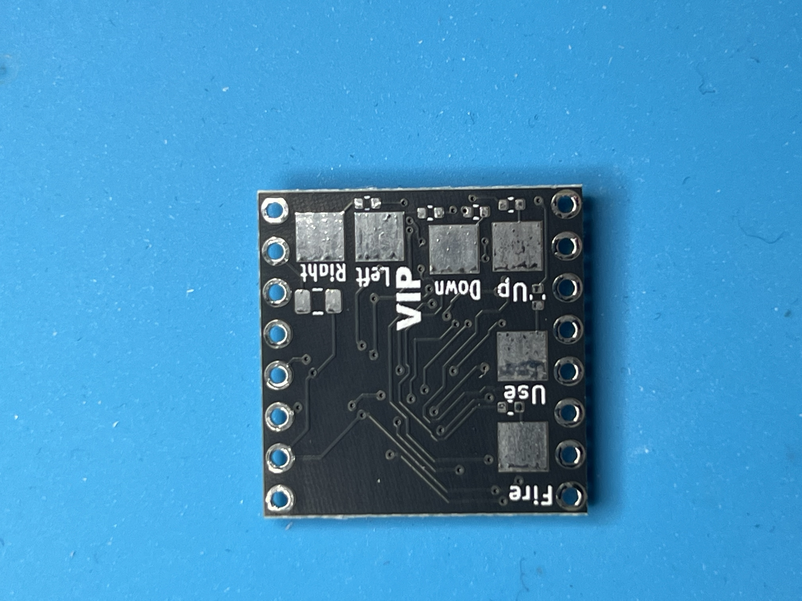
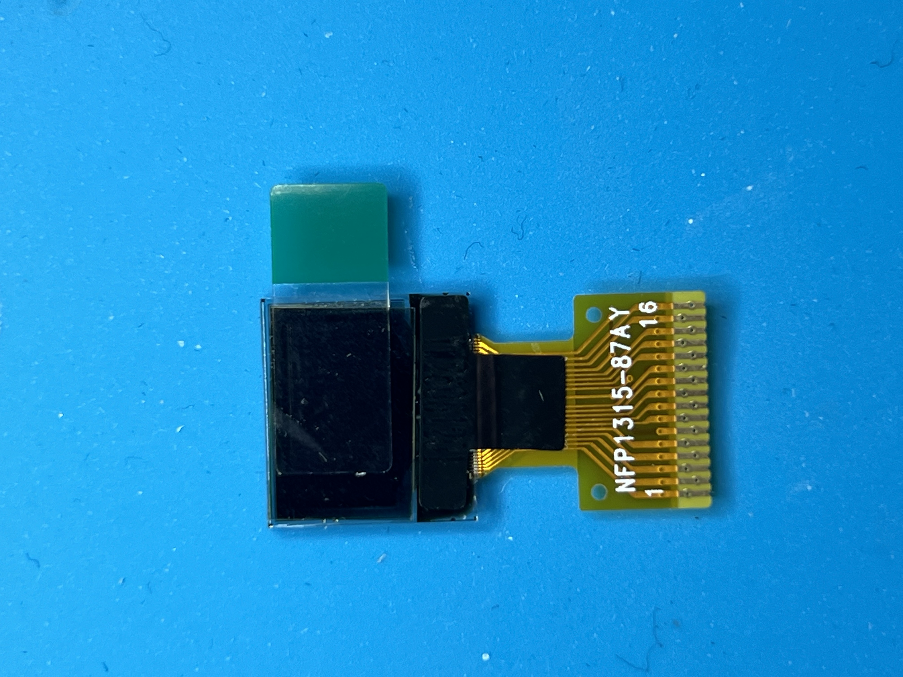
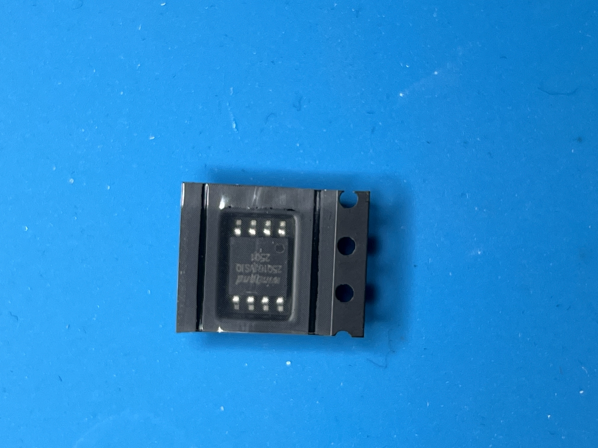
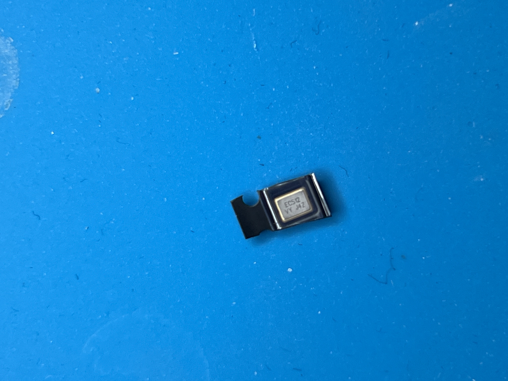
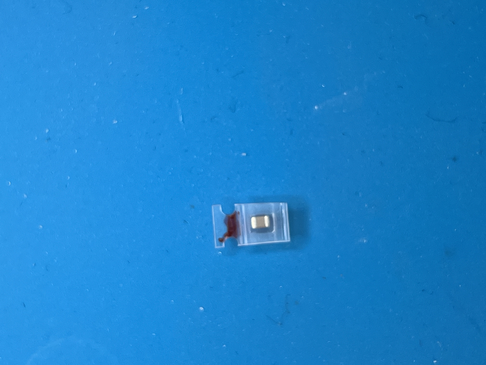
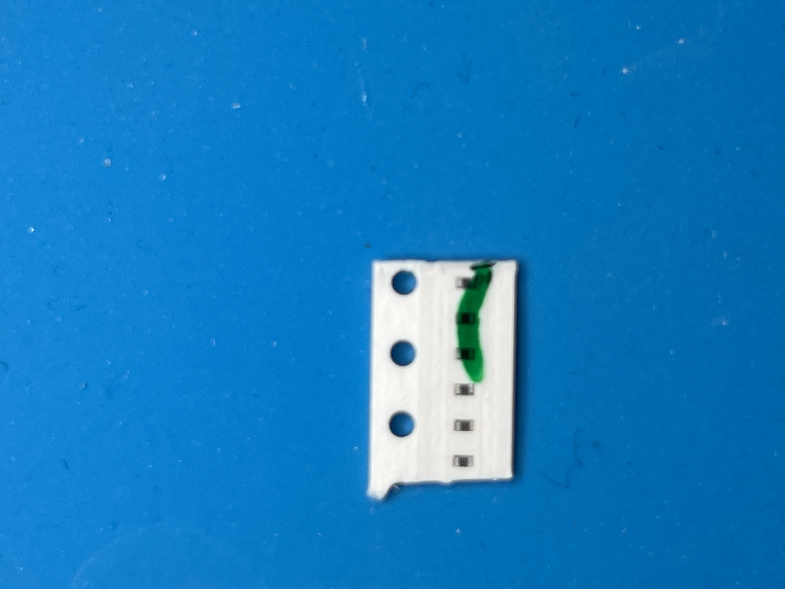
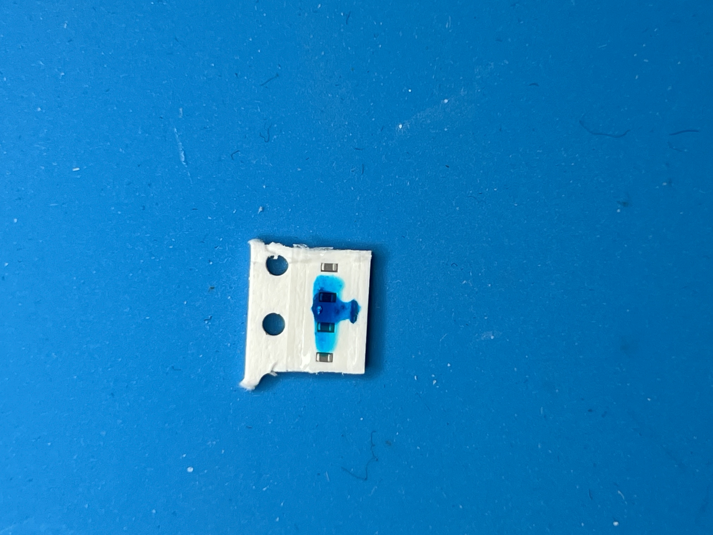

# Doom Minibadge

## Project Description.
This is my Doom Minibadge! I have probably spent over 50 hours making this badge, debugging, and more; be aware it is held together with duct tape, zip ties, and hopes and dreams.
__NOTES:__
+ This badge is not done yet. I am still working on making it work. I will tell you where I got it wrong, and you can try to fix it. I am working on a solution as we speak.
+ There are LOTS of small parts, I only give you the required amount of parts, __YOU CANNOT LOSE THESE, I CANNOT REPLACE THEM__. Only take this if you are VERY good at soldering.
+ You will need bodge wire! (yayyyy... .  . .) I recommend 32 AWG; the minimum is 36 AWG, and the max is 26 AWG. I recommend 32, though, as it works so well for the display bodging.
+ Programming is super fun, I will have the files in this workspace, but you will need a Pi Pico set as a debugger, with Pico tester installed. I can help you flash it, so contact me over Discord.
+ Your badge just might not work! This has been such a hard project; I haven't been able to double-check every badge, you might just get one with a dead chip, tough luck. I have VERY few of these, so no replacements.
+ This is supposed to be fun, if you're not having fun soldering this, you shouldn't.

## Material list
1. Board 
2. Display (0.42") 
3. U2 (the real name is very long, I'm not pasting it here, but it's the chip-looking thing with 8 pins) 
4. Crystal 
5. Main Cap 
6. #6 Touch Pad Resistors 
7. #4 Display Caps 
8. Headers (there are only 2, 2, and 3 required; you do not need all the header spaces)
9. 32 AWG Wire (lots of it, I recommend 3 different colours; I used red, yellow, and blue)
10. __FLUX FLUX FLUX FLUX FLUX FLUX FLUX FLUX FLUX FLUX FLUX FLUX FLUX FLUX FLUX FLUX FLUX FLUX__

# Instructions
First, You're gonna want to solder top-side comps.

### Top
+ You will need the Touch Pad Resistors (TPR). Each TPR goes on the unmarked small pads on the board, they are all near their respective TP.
+ The main Cap is the only thing left on this side, that one is right next to the top right 3v3 pin. Do not short this one, we'll also be bodging some wires from here, later.
Now, let's flip to the back of the board for some easier parts to handle

### Bottom
+ You're going to want to solder U2 first, but be careful, the piece is bigger than the footprint. I recommend (committing an electrical sin) bending the legs backwards; they should be facing inwards, and U2 should be above the ground a little bit; that's fine, as we are putting on the headers later. The little indent on U2 should be oriented to the white arrow on the board (see image below) 
+ The crystal is a little bit harder, but not by much. It is found right below the FPC connector (see image below) and is non-polar. I recommend tilting it to a 45-degree angle, having one side facing towards you as you solder, or you could use rework or something. 
+ I'd like to point out really quickly that there are a lot of "missing parts" on the board: solder points with nothing on them. This is not intentional, but at this point, everything on the board is done (with the exception of headers), everything off it requires the remaining parts
+ Solder the headers on; you can do the entire row, but if you're doing just 2,2,3 headers, the headers should look like this image... 

## Display Bodge wires
One quick message to all you out there: the display bodging is not for the faint of heart, neither is connecting to the FPC pins, nor any of the rest of this. I recommend magnification for this section; I used +3.00 glasses, and it worked well. Anything else will do, too, but make sure the board is stationary. You will need a very fine tip for this stuff... and probably an afternoon.

### Caps
This one is by far the hardest, so buckle up.
To start, apply solder to pins 1-4 on the display; none of the others quite yet. You need to solder the display caps onto these pins, bridging 1-2 and 3-4 (see below)<br>
<br>

### Ordering
Now, solder pin 5 on the opposite side of the display, then 7, then 9, all the way to 13 (15 we'll talk about later). For these, you need a Bodge wire on every one of them. No exceptions. I recommend using a different coloured wire for these odd-numbered pins.<br>
<br>
All the even-numbered pins (besides 14 and 16; 16 we do later) need solder on them, on the opposite side of the odd-numbered ones. I recommend a different colour for these wires, too.<br>
<br>

Pins 15 and 16 need caps on them, but caps to the pin, then to bodge wires. Be careful the bodge wire does not directly touch the pin; best practice is to stand the cap up like a tombstone.<br>
<br>

### Attaching Bodge wires
   - Display pin 5 (VBAT) -> J3 PAD 5 (or 3v3)
   - Display pin 7 (VDD)  -> J3 PAD 7 (or 3v3)
   - Display pin 6 (VSS)  -> J3 PAD 6 (or GND)
   - Display pin 8 (BS1)  -> J3 PAD 6 (or GND)
   - Display pin 9 (CS)   -> J3 PAD 9
   - Display pin 10 (RES) -> J3 PAD 11
   - Display pin 11 (DC)  -> J3 PAD 10
   - Display pin 12 (SCLK)-> J3 PAD 12
   - Display pin 13 (SDIN)-> J3 PAD 13
   - Cap grounds (pin15, pin16 caps) -> J3 PAD 6 (or GND)


## Non-display Bodge Wires
For all these caps, you need to solder the 3V3 side. Make sure you get the right one so you don't short the badge; look at the schematics for this.<br>
+ Bodge wire from C1 to 3v3
+ Bodge wire from C2 to 3v3
+ Bodge wire from C3 to 3v3

# Flashing
You will need a Pico for this part.
## Part 1 — Build the Picoprobe (one-time, ~5 min)

1. Download `debugprobe_on_pico.uf2` from:
   https://github.com/raspberrypi/debugprobe/releases
   (older name: `picoprobe.uf2` — either works)

2. On the SPARE Pico: hold the BOOTSEL button while plugging in USB.

3. It mounts as a USB drive named `RPI-RP2`.

4. Drag `debugprobe_on_pico.uf2` onto that drive.

5. The Pico reboots. It is now a permanent SWD programmer. Done forever.

---

## Part 2 — What the Picoprobe Pins Do

On the Picoprobe (the spare Pico), these are the pins you use:

```
Picoprobe Pin | Role              | Goes to badge
--------------|-------------------|-------------------
GP2           | SWCLK (debug clk) | badge SWCLK (PROG)
GP3           | SWDIO (debug data)| badge SWDIO (PROG)
GND           | ground            | badge GND
3V3(OUT) pin36| 3.3V power        | badge 3.3V (optional, see below)
```

GP2 and GP3 are physical pins 4 and 5 on the Pico (top-left area).
GND is any of the Pico's GND pins (e.g. physical pin 3 or 38).
3V3(OUT) is physical pin 36.
## Part 2.2 - Breadboard
I __HIGHLY__ recommend using a breadboard for programming, use the same GND and 3V3 for every pin that needs it. It makes it so much easier. I also recommend having crocodile clips for debugging later.
## Part 3 — Wiring It Together (4 wires)

```
Picoprobe        Badge
---------        -----------------------------
GP2         -->  PROG1  (J1 pin 3)  = SWCLK
GP3         -->  PROG2  (J1 pin 4)  = SWDIO
GND         -->  GND
3V3(OUT)    -->  3V3                (powers the badge)
```

### Powering the badge — two choices:
- EASIEST: let the Picoprobe's 3V3(OUT) pin power the badge (wire above).
  Fine for a bare badge drawing little current.
- OR: plug the badge into the real minibadge host (it supplies 3.3V), and then
  only connect SWCLK, SWDIO, GND from the probe (leave 3V3 disconnected).

Do NOT power the badge from BOTH the probe's 3V3 AND the host at the same time.
Pick one power source.

## Part 4 — Flash (from WSL or Windows)

With the 4 wires connected and the badge powered:

```
picotool load -v doom_tiny_ssd1306.uf2 -f          # firmware
picotool load -v -t bin doom1.whx -o 0x10040000   # WAD data
picotool reboot                             # run it
```

Disconnect the probe. DOOM runs.

(Full build + picotool install steps are in FLASH_PLAN.md.)

## Troubleshooting

```
Symptom                          | Fix
---------------------------------|-------------------------------------------
"No accessible RP2040 device"    | Swap SWCLK/SWDIO wires; check GND; confirm
                                 | badge is powered (3.3V present)
"Unable to connect" / timeout    | Reflash debugprobe uf2; try another USB port
Probe not seen by PC at all      | Bad USB cable (power-only cable?) — use data
Connects but flash fails         | Lower adapter speed, re-seat wires
Badge dead after flash           | Check 3.3V, check RP2040 solder joints
```
